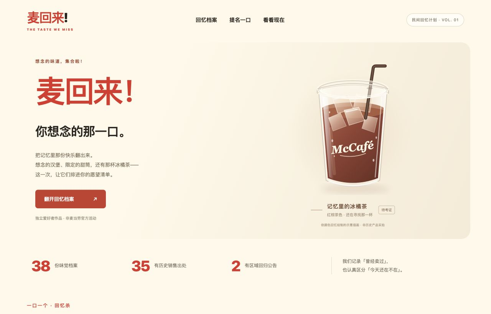

# 麦回来！

有些味道，值得再见一面。麦回来是一个独立的麦当劳历史单品回忆项目：用有出处的档案保存旧味道，留下复售愿望，并从官方 MCP 看看当月新消息。

参考 [mcd-calorie-butler](https://github.com/WilderNoTrack/mcd-calorie-butler) 的 Skill + 示例应用组织方式，文字、界面与代码为本项目新写。不是麦当劳官方活动，不承诺复售。

项目仓库：[suikv000/mai-hui-lai](https://github.com/suikv000/mai-hui-lai)



## 为谁而做

给想找回季节限定口味、愿意提供旧菜单线索的麦当劳爱好者，也给需要核对历史来源的内容整理者。用公开证据保存味觉记忆，让同一服务中的复售愿望形成可排序的清单；“想它回来”是爱好者表达，不代表产品已经全国停售或官方承诺复售。

## 运行

需要 Python 3.10+，无第三方依赖。

```sh
git clone https://github.com/suikv000/mai-hui-lai.git
cd mai-hui-lai
python3 server.py
```

浏览器打开 http://127.0.0.1:8765。可用 `--port 8766` 指定其他端口。默认只监听本机回环地址，不适合直接作为公网服务器。

- 38 份档案：35 份历史销售有出处，2 份区域回归公告，1 份待考证用户提名。
- 搜索名称、年份、备注及别名；类别和证据状态筛选；详情保留日期含义、来源链接。
- 按许愿数降序排列，同票保持档案顺序；每个匿名浏览器每款一个心愿，可撤回。SQLite 汇总当前服务记录，没有预填票数。
- 提名只存浏览器，可删除；愿望清单可复制，剪贴板不可用时下载文本。不会自动发送。
- 原创文字插画不是产品照片；产品是否当前供应需向具体门店另核实。

提名仍保存在本浏览器，禁止 localStorage 时仅本次页面有效。心愿由服务端生成的 HttpOnly / SameSite=Strict 匿名 Cookie 识别，存入 `runtime/votes.sqlite3`，服务器重启保留。清除 Cookie 会成为新匿名访客，历史汇总仍在；这些是浏览器心愿记录，不是经过核实的独立人数，也不具备反刷能力。只有连接当前服务的浏览器共享计数；项目仍仅监听本机，未公开部署。没有账户、跨设备身份同步或提交官方通道。

旧版本 localStorage 心愿会在首次成功连接后合并迁入当前匿名访客，服务器记录导入标记，重复请求不会重复计数，也不会复活已撤回心愿。迁移成功前保留旧记录；失败显示未同步并禁用投票，可点击“刷新心愿数”重试。提名不迁移、不上传。请备份 `runtime/` 保留服务心愿，不要提交数据库到 Git。

## 试用一遍

1. 搜索“冰橘茶”：查看用户提名与待考证状态；再搜索“玄米茶”，打开档案中的官方历史来源。
2. 给想再尝一口的单品点“想它回来”，切回全部档案，观察“按许愿数排序”。再次点击可撤回。
3. 在另一个独立浏览器连接同一地址并许愿，点击“刷新心愿数”查看当前服务汇总；匿名浏览器不等于核实人数。
4. 在“提名一口”写下产品名、年份和城市，导出自己的愿望清单。提名保存在本浏览器，不自动上传或发送。
5. 配置服务端环境变量后，点“查询官方当月活动”读取官方 MCP。未配置时会显示明确提示，不能把离线档案当成当日供应证明。

## 官方 MCP

[接入说明](MCP_INTEGRATION.md) 描述仅当月活动的只读查询。离线档案和本机交互不需要令牌。若要查询，在启动服务前将 `MCD_MCP_TOKEN` 放入该终端的环境变量；不要把实际令牌写进文件或浏览器。

本项目已实现 MCP 初始化、工具发现和只读活动调用，但本项目尚未完成带有效令牌的官方在线联调。现有通过项是模拟传输测试与本地功能验证，不是官方实时成功证明。

配置示例 [mcp-config.example.json](mcp-config.example.json) 是通用结构，客户端字段与环境变量插值方式须按所用客户端说明调整。服务端从环境读取变量，不读取此示例。

## 安装技能

`skills/mai-hui-lai` 自带档案快照，可单独安装：

```sh
python3 install_skill.py --target ~/.codex/skills
```

显式指定技能父目录；遇到已有同名技能拒绝覆盖。安装器不会修改 MCP 设置，也不会保存令牌。重启/重新加载客户端后，使用 `$mai-hui-lai`，例如：“帮我找 2016 年麦咖啡旧饮品，区分公开证据和用户回忆”。

## 数据与核验

`data/products.json` 和技能内快照来自工作区 `research/mai-hui-lai/products.json`（2026-10-18），本项目不修改研究原件。来源链接保存在同一 JSON 内，MHL001 仍待考证。维护时同步两份快照，复核原始证据后再更改状态。

```sh
python3 -m unittest discover -s tests -v
```

测试覆盖档案出处、凭据边界、HTTP 同源边界、匿名心愿幂等/汇总/撤回/持久化/旧票导入，以及模拟 MCP JSON/SSE、会话、工具错误。模拟测试不等于官方在线测试；没有环境令牌时，运行应用不会声称查询成功。

## 参赛状态

报名 [Issue #854](https://github.com/M-China/mcd-developer-innovation-challenge/issues/854) 已提交，官方校验结果以 Issue 回复为准。

附 [官方参赛声明](CONTEST_DECLARATION.md) 原文及所需接入说明。这是可运行本地演示。比赛规则与登记入口以 [官方挑战赛仓库](https://github.com/M-China/mcd-developer-innovation-challenge) 及其 [报名 Issues](https://github.com/M-China/mcd-developer-innovation-challenge/issues) 为准。仓库公开、报名登记和真实 MCP 联调是独立事项，不以其中一项代替其他项。未宣称使用 WorkBuddy，不借用参考项目测试或参赛成绩。

## 权利说明

本项目原创代码、界面与技能文字采用 [MIT License](LICENSE)。档案为事实摘要与来源索引，不授予链接页面、产品商标或其他权利人内容的权利。麦当劳及各产品名称属于相应权利人；官方参赛声明按原文保留，不属于本项目原创许可范围。
